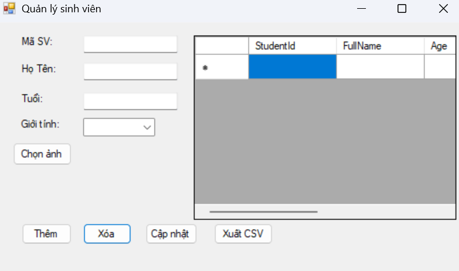
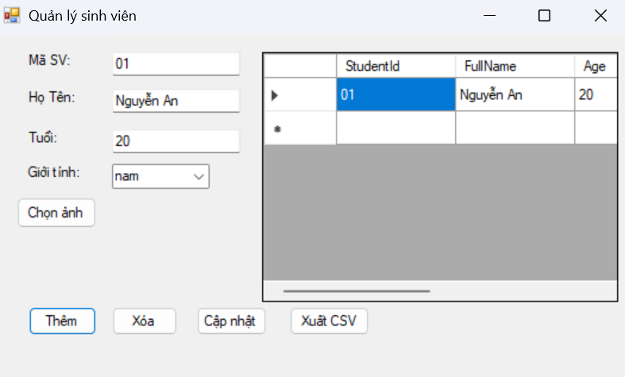
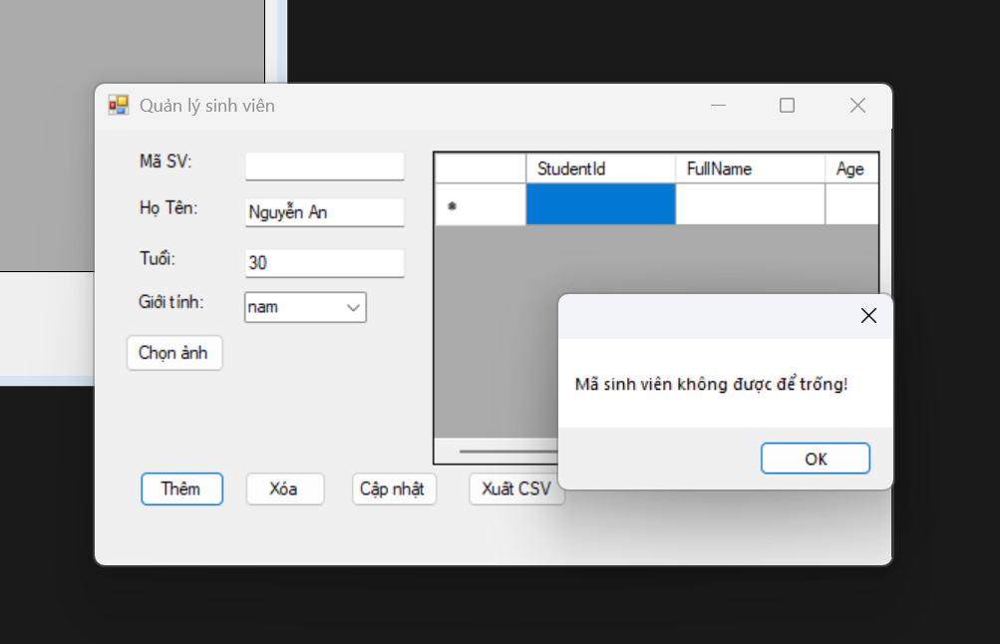

## THÔNG TIN SINH VIÊN
- **Họ và tên:** Nguyễn Văn An
- **Mã số sinh viên:** 24810320020
- **Lớp:** D19QTANM1
- **Tên môn học:** Laptrinh.net
- **Tên bài tập:** Bai4.6

---

## KẾT QUẢ THỰC HÀNH

### 1. Ảnh màn hình Giao diện chính

### 2. Ảnh màn hình Chức năng thực thi / Kết quả

### 3. Ảnh màn hình Kiểm tra lỗi 

